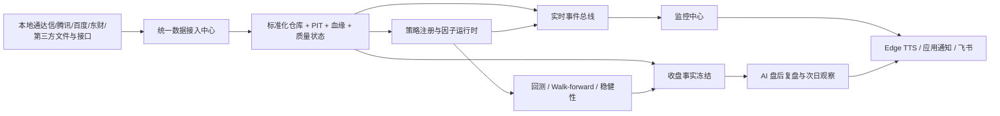

# TickFlow 能力原生整合设计

> 状态：已获用户确认，进入实施阶段
>
> 依据：对 `shy3130/tickflow-stock-panel` `v0.1.88`（提交 `9b9538a`）的代码级审计，以及现有一树-A股观测台的策略、回测、数据、语音、调度和 EXE 交付约束。

## 1. 目标与非目标

### 目标

在现有一树-A股观测台中原生实现以下能力：

1. 可注册、可验证、可启停的策略插件和复合策略。
2. CSV、TSV、XLS、XLSX、JSON、JSONL、Parquet、SQLite、DuckDB 和 ZIP 数据导入，统一进入真实数据仓库。
3. 通达信、现有公开行情源和第三方数据源的多源同台分析，保留来源、观测时间、数据质量和冲突裁决证据。
4. A 股约束下的单股、策略组合、因子分层、参数优化和 walk-forward 回测。
5. AI 策略草稿、标的研究和盘后复盘，但 AI 只能解释或生成受控配置，不能绕过确定性风控。
6. 一级菜单“监控中心”，支持价格、量价、策略、新闻、板块和风险闸门条件，触发 Edge TTS、应用通知和飞书。
7. 收盘后自动冻结事实、生成结构化复盘报告，按设置推送飞书，并保留可追溯版本。
8. 所有新能力保持缓存优先、后台增量计算、单域失败不清空其他域，且最终通过 Windows EXE 验收。

### 非目标

- 不复制外部仓库的 Web 页面、品牌、演示数据或整套后端。
- 不把外部仓库文档中的“123+ 因子”“全部可用”等宣传内容当作事实。
- 不允许 AI 生成的任意 Python 代码在主进程或未隔离环境直接执行。
- 不自动下单、不输出保证收益或把综合分伪装为概率。
- 不关闭、重启或控制用户已运行的通达信，也不把浏览器或 localhost 作为用户交付入口。

## 2. 外部能力取舍

| 外部能力 | 处理方式 | 原因 |
|---|---|---|
| 策略注册表与策略元数据 | 重建为现有 Python/Pydantic 契约 | 保持现有策略和量化候选兼容 |
| Polars 向量化扫描 | 复用现有扫描和 DuckDB/Parquet 快照 | 已有性能与数据水位治理 |
| 矩阵回测与缓存 | 扩展现有 `zhongshu.backtest`，不复制实现 | 统一 T+1、PIT、A 股撮合边界 |
| 复合策略 | 新增受控 JSON/DSL 组合层 | 避免动态执行和依赖膨胀 |
| CSV/XLSX/JSON/Parquet 扩展数据 | 复用现有导入基础，扩充格式和校验 | 当前已支持部分上传与 Parquet 落盘 |
| 监控规则 | 扩展现有实时事件总线与告警收件箱 | 不再建立第二套实时链路 |
| 浏览器语音播报 | 保留为兼容回退，默认接 Edge TTS | EXE 需要稳定的中文自然语音 |
| 飞书 Webhook | 复用现有签名、队列和重试 | 已存在监控与盘后推送能力 |
| 外部 AI 代码沙箱 | 不直接移植 | 外部仓库明确仍有受限子进程待实现标记 |

外部仓库为 MIT，但 README 同时写有“严禁商业用途”，授权表述存在冲突。当前只吸收设计思想和公开接口形态；任何代码复制必须另行确认许可证兼容性并保留版权声明。

## 3. 总体架构

### 3.1 数据接入契约

新增统一 `DataSourceAdapter` 协议，至少包含：

- `source_id`、`version`、`capabilities`、`priority`。
- `discover()`：探测来源和字段，不写正式库。
- `fetch(request)`：返回原始批次和来源元数据。
- `normalize(batch)`：输出统一证券、日期、时间、单位和字段命名。
- `health()`：返回 `ready/partial/stale/unavailable`、延迟、覆盖率和原因。

所有标准化记录必须携带 `source_id`、`observed_at`、`as_of`、`ingested_at`、`content_hash` 和 `quality_status`。同一字段冲突时按“点时有效、来源优先级、新鲜度、覆盖率”裁决，原始记录永不覆盖。

### 3.2 扩展数据导入

导入流程固定为：

1. 临时目录接收文件并计算 SHA-256。
2. 自动识别 ZIP、编码、分隔符、表格工作表和 JSON 行数组。
3. 预览字段、股票代码、日期、单位和异常行。
4. 用户确认或使用明确映射后写入隔离 Parquet 分区。
5. 运行 schema、代码、日期、重复、单位和未来数据检查。
6. 检查通过后原子发布数据版本和查询视图。

无法识别或校验失败的数据只能进入隔离区，并显示中文原因，不能污染正式指标。

### 3.3 策略与 AI 契约

策略定义必须是可序列化的元数据和受控表达式：

- 输入字段白名单、时间周期、适用资产、参数定义。
- 入场、出场、止损、止盈、最大持仓天数和风险闸门。
- 需要的因子、数据覆盖要求和证据来源。
- 版本号、创建者、来源（内置/自定义/AI/复合）和内容哈希。

AI 只生成 `StrategyDraft`，经过 schema 校验、字段白名单、PIT 检查、样本门槛、walk-forward 和风险闸门后才能转换成启用策略。AI 不能修改原始数据、裁决来源、回测成本或最终风险状态。

### 3.4 回测边界

回测统一采用：

- 信号日产生，次一可交易日开盘成交。
- 100 股整手，余额不足不成交。
- 佣金、最低佣金、印花税和滑点均进入成本。
- 停牌、零成交、涨停封板买入和跌停封板卖出不可成交并记录原因。
- 交易规则按股票板块和历史交易日生效，不使用未来涨跌幅规则。
- 训练、验证、样本外区间严格隔离；参数在验证前冻结。
- 少于 5 笔闭合交易、关键字段缺失或生存偏差未解决时，禁止输出结论性胜率、Sharpe 或概率。

输出必须含请求快照、数据版本、策略版本、成本配置、交易明细、权益曲线、回撤、样本分段、市场阶段、信号衰减、警告和证据状态。

### 3.5 监控中心

规则模型包含：

- 价格/涨跌幅、量比/换手/成交额、技术信号。
- 策略新增/退出候选、板块扩散、新闻影响、涨跌停和风险闸门。
- AND/OR 条件、冷却时间、有效期、严重级别和股票/全市场作用域。

每次命中写入不可变告警事件，包含规则版本、输入快照哈希、具体命中条件、股票名称、数据时间、延迟和投递状态。TTS、系统通知、飞书投递分别排队，外部投递失败不阻塞行情轮询。

### 3.6 盘后复盘

收盘后按确认交易日执行：

1. 核对行情、新闻和策略数据覆盖。
2. 冻结市场事实、候选表现、信号命中、风险变化和数据质量。
3. 生成确定性结构化摘要。
4. 在 AI 可用时追加证据绑定的解释、主线归因、反方风险和次日观察条件。
5. 保存不可变版本并根据渠道设置推送飞书。

报告状态使用 `ready/partial/stale/unavailable`。AI、飞书或单个数据源失败时保留事实报告并记录中文失败原因。

## 4. 性能与 EXE 约束

- 首帧继续从本地快照恢复，不等待全市场扫描、AI、回测或 TTS。
- 所有重计算进入后台任务；读取 API 不同步启动全市场扫描。
- 同一数据版本和请求使用 single-flight，避免重复计算。
- 回测、导入、复盘和数据同步都必须暴露阶段、真实进度、已处理量、耗时和失败原因。
- 页面切换不取消仍有价值的后台任务；换股或卸载才取消对应任务。
- 新功能必须通过 `scripts/build-portable.ps1` 和 `scripts/run-portable-smoke.ps1 -UseReleaseData` 验收。
- 构建时保留 `config/data/news/cache/logs/models/exports/backups`。
- 不关闭、重启或控制用户通达信；烟测完成立即释放自动测试进程。

## 5. 分阶段交付

### P0：契约与数据版本

统一策略、数据源、导入、回测任务、告警和复盘结果的 Pydantic 契约；建立数据版本、来源血缘和任务进度接口。

### P1：策略与回测

增加受控策略注册、复合策略、因子分层回测、组合回测、参数稳健性和样本外报告；迁移已有量化策略而不改变旧接口。

### P2：扩展数据与多源

完成多格式导入、第三方适配器注册、字段映射、冲突裁决和隔离区；首期接入现有本地 TDX、腾讯、百度、东财和用户文件。

### P3：监控中心

增加一级菜单和规则编辑器；接入实时事件总线、Edge TTS、系统通知、告警历史、冷却与飞书队列。

### P4：盘后复盘与 AI

扩展盘后冻结、复盘版本、AI 证据解释、次日观察和飞书推送；保留 AI 不可用时的确定性报告。

### P5：EXE 性能和发布闭环

完成缓存迁移、后台任务恢复、性能账本、失败重试、全量 API/Web 测试、构建、smoke、恢复演练和发布质量门禁。

## 6. 验收标准

1. 旧信息总览、个股观察、公司研究、量化分析、新闻热点和风险提醒接口行为不回退。
2. 任意导入文件都能得到“已识别/已导入/已隔离/失败原因”之一，不出现无提示空白。
3. 回测结果能复现：相同数据版本、策略版本和请求快照得到相同哈希和结果。
4. 监控命中可在 EXE 内看到、听到（已启用 Edge TTS 时）并按设置推送飞书；失败状态可追溯。
5. 盘后复盘按真实交易日生成，报告和推送都带交易日、生成时间、数据覆盖率和来源。
6. 全量测试、乱码扫描、构建、EXE smoke、恢复演练和发布质量门禁通过；任何真实数据不足仍显示 `partial/unavailable`，不伪造 `ready`。

